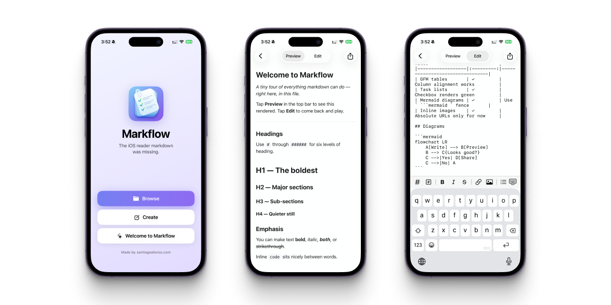

<h1>Markflow</h1>

Open Markdown files on your iPhone as rendered documents. 
Read, edit, save or share them without moving the file into another app.

<strong>Version 0.2.0</strong> · iOS 26+

  
  
  

  

Tap a `.md` file in Files, Mail or Safari and Markflow opens it rendered, for anyone who keeps notes or docs in Markdown and reads them on the phone.

- Code blocks, Mermaid diagrams, tables and images render as you'd expect.
- Files open read-only, so nothing changes until you choose Save.
- Edits write back to the original file, or to a new one.

## How it works

Tap the floating eye and pencil button to switch between Preview and Edit. Edits stay in memory until you Save, Save as New File, Share or Export as PDF. In Edit, a toolbar covers headings, emphasis, links, images, lists, quotes and code; images you insert are saved beside the Markdown file. Settings has five themes, six fonts, light and dark appearance, and whether files open in Edit or Preview. The full tour is in [docs/how-it-works.md](docs/how-it-works.md).

## Limits

Images stored next to a file you open from Files or another app (``) don't display yet. Images you insert with Markflow, and images with web addresses, do.

## Install

Get it on the [App Store](https://apps.apple.com/us/app/markflow-markdown-reader/id6763440990). To build it, you need Xcode 26 and [XcodeGen](https://github.com/yonaskolb/XcodeGen): run `xcodegen generate` in `Markflow/` and open the project. Support is in [docs/support.md](docs/support.md), or email [hi@santiagoalonso.com](mailto:hi@santiagoalonso.com).

---

[MIT](LICENSE). Markflow bundles [marked](https://github.com/markedjs/marked), [highlight.js](https://github.com/highlightjs/highlight.js) and [Mermaid](https://github.com/mermaid-js/mermaid), and the [iA Writer Quattro](https://github.com/iaolo/iA-Fonts) and [JetBrains Mono](https://github.com/JetBrains/JetBrainsMono) fonts under the SIL Open Font License.

Made by [santiagoalonso.com](https://santiagoalonso.com)
